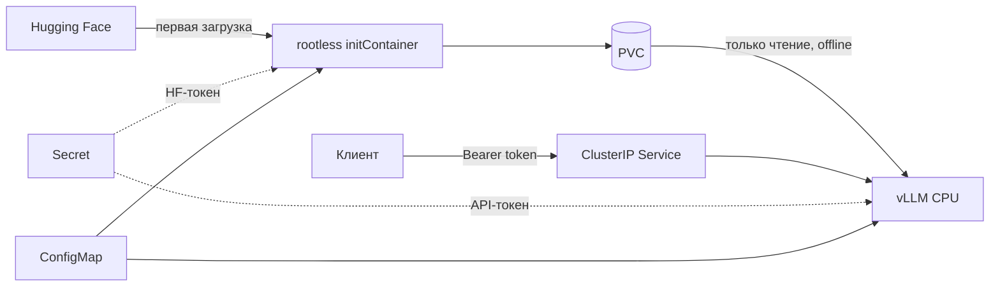

# CPU inference with vLLM on Kubernetes

Решение тестового задания Data Engineer (стажёр), команда исследования
технологий машинного обучения Kaspersky. Сервис предоставляет OpenAI-compatible
API instruct-модели на CPU с аутентификацией и приватными логами.

## Статус проверки

- Пройдены все 11 тестов внутри Linux-контейнера без сети: приватность логов,
  защита настроек, целостность кэша и прерывание загрузки.
- Проверены синтаксис Python/PowerShell и сборка Kustomize.
- Собран rootless-образ загрузчика; зависимости согласованы.
- Модель скачана, повторный запуск загрузчика с реальными весами проверен
  через `--network none`: получен `model_cache_hit`.
- Сборка основного образа, загрузка модели и подготовка Minikube выполняются.
- Генерация ответа, деплой и нагрузочные метрики пока не подтверждены.

[План](docs/PLAN.md) · [Критерии приёмки](docs/REQUIREMENTS.md)

## Конфигурация

| Параметр | Значение |
| --- | --- |
| Платформа | Linux amd64, CPU с AVX512 |
| Python | 3.12.12; базовый образ закреплён по digest |
| vLLM | 0.27.1, CPU wheel с закреплённым URL и SHA256 |
| PyTorch | 2.13.0+cpu |
| Модель | `HuggingFaceTB/SmolLM2-135M-Instruct` |
| Revision | `12fd25f77366fa6b3b4b768ec3050bf629380bac` |
| Вычисления | BF16, без квантизации |
| Контекст / параллельные последовательности | 2048 / 4 |
| KV cache | 1 GiB |
| Minikube | 6 CPU, 10240 MiB RAM |
| Сервер | requests: 2 CPU / 4 GiB; limits: 6 CPU / 8 GiB |

Компактная открытая instruct-модель выбрана для уменьшения объёма загрузки
и стоимости проверки. Её качество ответов ограничено; задача проекта —
организация сервиса инференса. Model ID и revision меняются через ConfigMap.

## Архитектура



InitContainer скачивает зафиксированную revision во временный каталог на PVC.
После загрузки записывает manifest с размерами и SHA256 файлов и атомарно
переименовывает каталог. Файловая блокировка сериализует загрузки; после
прерывания используется тот же временный каталог. Повреждённая готовая копия
отклоняется.

При готовой копии загрузчик не импортирует HF и не обращается к сети.
Основной процесс проверяет локальный snapshot и принудительно включает
`HF_HUB_OFFLINE` и `TRANSFORMERS_OFFLINE`. HF-токен серверу не передаётся.

## Локальный запуск на Windows

Нужны Docker Desktop с Linux engine, `kubectl`, Minikube и Python для клиентских
скриптов. Minikube устанавливается по [официальной инструкции](https://minikube.sigs.k8s.io/docs/start/)
или размещается в `.local/bin/minikube.exe`. Использован Minikube `v1.39.0`.
Для сборки и первой загрузки нужен интернет.

Из PowerShell в корне репозитория:

```powershell
docker desktop start
powershell -NoProfile -ExecutionPolicy Bypass -File .\scripts\preflight.ps1
powershell -NoProfile -ExecutionPolicy Bypass -File .\scripts\start-local.ps1
```

`-ExecutionPolicy Bypass` относится только к запускаемому процессу PowerShell.
Скрипт собирает образы, создаёт отдельный кластер `kaspersky-vllm-cpu`,
загружает образы в кластер, создаёт Secret, применяет манифесты и ждёт готовности.
Все команды явно выбирают кластер проекта. Повторный запуск с готовыми образами:

```powershell
powershell -NoProfile -ExecutionPolicy Bypass -File .\scripts\start-local.ps1 -SkipBuild
```

API-токен генерируется один раз и сохраняется в `.local/api-token`. Его значение
не выводится в консоль и не передаётся аргументом командной строки. Для открытой
модели HF-токен не нужен: поле `hf-token` в Secret пустое. Для gated-модели
задайте `HF_TOKEN` в окружении перед запуском.

Откройте API на localhost в отдельном терминале:

```shell
kubectl --context kaspersky-vllm-cpu -n llm-inference port-forward service/vllm 8000:8000
```

Пример запроса:

```powershell
$apiToken = (Get-Content -LiteralPath .local\api-token -Raw).Trim()
$payload = @{
    model = 'local-instruct'
    messages = @(@{ role = 'user'; content = 'Explain containers in one sentence.' })
    max_tokens = 32
} | ConvertTo-Json -Depth 5
Invoke-RestMethod -Uri http://127.0.0.1:8000/v1/chat/completions `
    -Method Post -ContentType application/json `
    -Headers @{ Authorization = 'Bearer ' + $apiToken } -Body $payload
```

## Ручная сборка и другой кластер

```shell
docker build -t kaspersky-model-downloader:dev -f downloader/Dockerfile .
docker build -t kaspersky-vllm-cpu:dev -f Dockerfile .
kubectl kustomize k8s/overlays/local
```

По умолчанию `imagePullPolicy: Never`: образы загружаются в Minikube через
`minikube image load`. Для другого кластера загрузите образы на его узлы либо
в свой registry и поменяйте имена образов и pull policy через Kustomize.
Нужны default StorageClass и Secret `vllm-secrets` с ключами `api-token`
и `hf-token` в namespace `llm-inference`.

## Изменение настроек без пересборки

- [model.env](k8s/base/config/model.env): model ID, полный revision и корень PVC.
- [runtime.env](k8s/base/config/runtime.env): KV cache и OpenMP.
- [inference.json](k8s/base/config/inference.json): dtype, контекст, batch limits,
  prefix caching, chunked prefill и eager mode.

После изменения:

```shell
kubectl --context kaspersky-vllm-cpu apply -k k8s/overlays/local
kubectl --context kaspersky-vllm-cpu -n llm-inference rollout status deployment/vllm
```

Kustomize меняет имя ConfigMap по хэшу, вызывая пересоздание Pod. Стратегия
`Recreate` исключает одновременную работу двух экземпляров; PVC сохраняется.
Launcher отклоняет параметры, которые подменяют модель, middleware, токен
или отключают защиту логов.

## Приватность и безопасность

Реализация: [logging.json](config/logging.json),
[SafeJsonFormatter](src/app/safe_logging.py),
[ASGI middleware](src/app/audit.py), [sitecustomize](src/sitecustomize.py).

Лог обращения содержит серверный request ID, разрешённый метод, известный
маршрут, статус и длительность. Неизвестные пути заменяются на `other`.
Тела, заголовки, query string и клиентский request ID не логируются.
Middleware не буферизует streaming-ответ.

Стандартные request/output/access-логи vLLM отключены. Произвольные сообщения
сторонних логгеров и traceback не форматируются: сохраняются уровень, имя
логгера, место вызова, тип ошибки и место её возникновения. Текст исключения
и строки исходного кода не выводятся. Это уменьшает детализацию диагностики, чтобы сообщения
исключений тоже не раскрывали промпт. Python warnings и необработанные
исключения переводятся в безопасный формат во всех Python-процессах сервиса.

Контейнеры имеют UID/GID `10001`, read-only root filesystem, запрет повышения
привилегий, сброшенные capabilities и `RuntimeDefault` seccomp. ServiceAccount
токен не монтируется. Отдельный образ загрузчика не содержит PyTorch/vLLM.

## Проверки

На Windows:

```powershell
$env:PYTHONPATH = (Join-Path (Get-Location) 'src')
python -m unittest discover -s tests -v
```

Два теста загрузчика требуют Linux file locking и на Windows пропускаются.
В Linux все тесты выполняются без сети:

```shell
docker run --rm --network none --read-only --tmpfs /tmp \
  --mount type=bind,source="$PWD/src",target=/app,readonly \
  --mount type=bind,source="$PWD/tests",target=/tests,readonly \
  --entrypoint python kaspersky-model-downloader:dev \
  -m unittest discover -s /tests -v
```

При открытом port-forward:

```shell
python scripts/smoke_test.py
```

Проверяются 401 без токена и с неверным токеном, ответ модели, streaming,
ошибка валидации, неизвестный путь и отсутствие контрольных промптов,
сгенерированных ответов и API-токена в логах сервера.

Проверка перезапуска:

```shell
kubectl --context kaspersky-vllm-cpu -n llm-inference rollout restart deployment/vllm
kubectl --context kaspersky-vllm-cpu -n llm-inference rollout status deployment/vllm
kubectl --context kaspersky-vllm-cpu -n llm-inference logs deployment/vllm -c download-model
python scripts/smoke_test.py
```

Ожидаемое событие загрузчика после перезапуска — `model_cache_hit`.
Запуск с готовым Docker volume дополнительно проверяется через `--network none`.
Linux-тест запрещает импорт HF на пути чтения готового кэша.

Полная проверка кластера при свободном порте 8000:

```shell
python scripts/check_cluster.py --benchmark
```

Скрипт сам открывает и закрывает port-forward, проверяет API и логи, запускает
отдельный Job на реальном PVC с запрещёнными Python-сетевыми вызовами и импортом
HF, пересоздаёт Pod и повторяет проверку API. Результат — `results/integration.json`.
CI выполняет тот же сценарий с [overlay для 2 CPU](k8s/overlays/ci/kustomization.yaml)
и `float32`, подходящим также для CPU без BF16-инструкций.

## Нагрузочное тестирование

```shell
python scripts/benchmark.py --requests 8 --concurrency 2 --max-tokens 32
```

Скрипт прогревает короткий и длинный сценарии отдельно. TTFT измеряется до
первого непустого content delta, latency — до завершения streaming-ответа.
Throughput — output tokens/s и requests/s по общему времени серии. Число
токенов берётся из stream usage. Префиксы запросов различаются, чтобы длинный
контекст целиком не переиспользовался из prefix cache. Результаты записываются
в `results/benchmark.json` без промптов и ответов.

Фактические измерения будут добавлены после подтверждённого CPU-запуска.

### Параметры для повышения throughput

Для большого потока коротких запросов стоит проверить увеличение
`max_num_seqs` и `max_num_batched_tokens`, чтобы объединять больше запросов
в batch. Prefix caching полезен при повторяющихся префиксах. Параллелизм
увеличивается до насыщения CPU; дальнейший рост может ухудшить задержки.

Для меньшего числа запросов с длинным контекстом стоит проверить chunked
prefill и подобрать `max_num_batched_tokens`. `max_model_len` ограничивается
фактической потребностью. Для большого контекста может потребоваться увеличить
`VLLM_CPU_KVCACHE_SPACE` вместе с memory limit. OpenMP threads и binding
согласуются с доступными CPU. Конкретные значения выбираются по замерам.

## Обновление зависимостей

Прямые зависимости находятся в `requirements.in` и `downloader/requirements.in`.
Полные lock-файлы рассчитаны на Linux amd64 / Python 3.12 и содержат SHA256.
Для обновления нужен `uv==0.13.6`:

```powershell
powershell -NoProfile -ExecutionPolicy Bypass -File .\scripts\lock.ps1
```

Для uv внутри проекта добавьте `-Uv .\.local\tools\bin\uv.exe`.
При установке основного образа явно указан `--torch-backend cpu`.
После обновления повторно проверяются сборка и инференс.

## Источники

- [vLLM 0.27.1: CPU](https://docs.vllm.ai/en/v0.27.1/getting_started/installation/cpu/)
- [CPU Dockerfile vLLM](https://github.com/vllm-project/vllm/blob/v0.27.1/docker/Dockerfile.cpu)
- [SmolLM2-135M-Instruct](https://huggingface.co/HuggingFaceTB/SmolLM2-135M-Instruct)
- [Minikube](https://minikube.sigs.k8s.io/docs/start/)

Оригинал задания, реальные токены, веса и сырые логи исключены через `.gitignore`.
Перед сдачей нужно предоставить проверяющим доступ к репозиторию и загрузить
файл со ссылкой, названный по инструкции задания.
