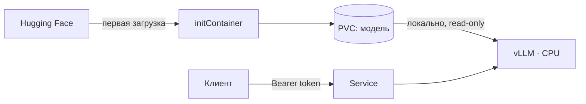

# vLLM CPU inference

Локальный сервис генерации текста: vLLM на CPU, OpenAI-compatible API и развёртывание в Kubernetes.
Модель скачивается при первом запуске, сохраняется на PVC и повторно используется без обращения к Hugging Face.

**vLLM 0.27.1** · **Python 3.12** · **Minikube** · **Kustomize** · [CI](https://github.com/MusiJusi/kaspersky-vllm-cpu/actions/workflows/validate.yml)

[Запуск](#запуск) · [API](#запрос-к-модели) · [Проверки](#проверки) · [Производительность](#производительность) · [Документация](#документация)

## Как устроено



- Два собственных Docker-образа: сервер и лёгкий загрузчик. Оба работают с UID `10001`.
- Зависимости закреплены по версиям и SHA256, модель — по commit SHA.
- API защищён Bearer-токеном. Логи содержат метаданные обращений без промптов, ответов и ключей доступа.
- Настройки передаются через ConfigMap, токены — через Secret. Изменение настроек перезапускает Pod без пересборки образа.

## Запуск

Понадобятся Docker с Linux containers, `kubectl`, Minikube и Python 3.12+ для клиентских скриптов.
Образы собираются для **Linux amd64**. Проверены Minikube 1.39.0 и Kubernetes 1.37.0.

| Профиль | CPU / RAM кластера | Инференс | Назначение |
| --- | --- | --- | --- |
| `local` | 6 CPU / 10 GiB | BF16, до 4 последовательностей | Локальный запуск на CPU с поддержкой BF16 |
| `ci` | 2 CPU / 5200 MiB | float32, до 2 последовательностей | Linux CI и запуск без BF16 |

Ниже — запуск в **Windows / PowerShell** с Docker Desktop.
[Ручной запуск на Linux и профиль float32 →](docs/RUNBOOK.md#linux--bash)

```powershell
git clone https://github.com/MusiJusi/kaspersky-vllm-cpu.git
cd kaspersky-vllm-cpu
docker desktop start
powershell -NoProfile -ExecutionPolicy Bypass -File .\scripts\preflight.ps1
powershell -NoProfile -ExecutionPolicy Bypass -File .\scripts\start-local.ps1
```

Скрипт собирает образы, запускает кластер `kaspersky-vllm-cpu`, создаёт Secret и применяет Kustomize.
При первом запуске нужны интернет и время на сборку и загрузку модели.
Для повторного запуска с готовыми образами добавьте `-SkipBuild` к последней команде.

Используется [SmolLM2-135M-Instruct](https://huggingface.co/HuggingFaceTB/SmolLM2-135M-Instruct):
компактная открытая модель для воспроизводимой проверки на CPU. HF-токен для неё не требуется.
API-токен создаётся автоматически и сохраняется в `.local/api-token`.

## Запрос к модели

В отдельном терминале откройте порт и оставьте команду работающей:

```shell
kubectl --context kaspersky-vllm-cpu -n llm-inference port-forward service/vllm 8000:8000
```

Из корня проекта в PowerShell:

```powershell
$apiToken = (Get-Content -LiteralPath .local\api-token -Raw).Trim()
$body = @{
    model = 'local-instruct'
    messages = @(@{ role = 'user'; content = 'Explain containers in one sentence.' })
    max_tokens = 32
    temperature = 0
} | ConvertTo-Json -Depth 5
$response = Invoke-RestMethod -Uri http://127.0.0.1:8000/v1/chat/completions `
    -Method Post -ContentType application/json `
    -Headers @{ Authorization = 'Bearer ' + $apiToken } -Body $body
$response.choices[0].message.content
```

Без корректного токена запросы к модели возвращают `401`. Для проверки состояния доступен `GET /health`.
Поддерживается streaming через `stream: true`.

## Проверки

Остановите ручной port-forward (`Ctrl+C`), затем выполните:

```shell
python scripts/check_cluster.py
```

Скрипт сам открывает порт 8000 и проверяет API, авторизацию, streaming, приватность логов,
offline-кэш и повторный запуск после пересоздания Pod. PVC сохраняется.

**17 unit-тестов** покрывают авторизацию, логи, конфигурацию, загрузчик и нагрузочный скрипт.
[Полный CI](https://github.com/MusiJusi/kaspersky-vllm-cpu/actions/runs/41511651299)
также проверяет сборку обоих образов и запуск с пустым PVC на отдельной Linux-машине.
[Команды и результаты →](docs/VALIDATION.md)

## Настройки

| Файл | Что меняет |
| --- | --- |
| [model.env](k8s/base/config/model.env) | Модель, зафиксированную revision и каталог хранения |
| [runtime.env](k8s/base/config/runtime.env) | Потоки OpenMP и размер KV cache |
| [inference.json](k8s/base/config/inference.json) | Тип данных, длину контекста, batching и prefix caching |

После изменения файлов:

```shell
kubectl --context kaspersky-vllm-cpu apply -k k8s/overlays/local
kubectl --context kaspersky-vllm-cpu -n llm-inference rollout status deployment/vllm
```

Kustomize обновляет имя ConfigMap и запускает новый Pod. Файлы модели остаются на PVC.
Для смены модели изменяются и ID, и полный commit SHA.

## Производительность

Ryzen 9 9955HX · лимит сервера 6 CPU / 8 GiB · BF16 · контекст 2048 · KV cache 1 GiB.
По 50 запросов на серию, 3 отдельных прогрева, ровно 32 выходных токена.
**300 измерений, 0 ошибок.** Конфигурация сервера между сериями не менялась.

| Ввод | Параллелизм | TTFT p50 / p95, с | Latency p50 / p95, с | Токенов/с | Запросов/с |
| --- | ---: | ---: | ---: | ---: | ---: |
| Короткий, 84 токена | 1 | 0.106 / 0.175 | 1.693 / 1.872 | 19.05 | 0.60 |
| Короткий, 84 токена | 2 | 0.195 / 0.218 | 1.694 / 1.795 | 38.02 | 1.19 |
| Короткий, 84 токена | 4 | 0.288 / 0.298 | 1.788 / 1.902 | **69.00** | 2.16 |
| Длинный, 918 токенов | 1 | 0.501 / 0.579 | 2.079 / 2.211 | 15.52 | 0.48 |
| Длинный, 918 токенов | 2 | 0.707 / 0.993 | 2.583 / 2.689 | 24.93 | 0.78 |
| Длинный, 918 токенов | 4 | 1.305 / 1.807 | 3.546 / 3.903 | **35.47** | 1.11 |

При переходе от 1 к 4 одновременным запросам throughput вырос в **3,62 раза** для короткого ввода
и в **2,29 раза** для длинного. Медианная задержка выросла на 6% и 71% соответственно:
большой контекст требует выбирать между общей пропускной способностью и временем ожидания.

Для потока коротких запросов стоит подбирать `max_num_seqs` и `max_num_batched_tokens`.
Для большого контекста — chunked prefill, бюджет batch и размер KV cache.
Влияние этих серверных параметров требует отдельного эксперимента.

Для повторения теста нужен открытый port-forward:

```powershell
python scripts/benchmark.py --requests 50 --concurrency-levels 1 2 4 `
    --max-tokens 32 --warmup-requests 3 --ignore-eos `
    --output results/extended/benchmark.json
```

Это один прогон на конкретном оборудовании. TTFT измеряется до первого фрагмента текста,
latency — до завершения ответа; p95 считается методом nearest rank.
[Методика и настройка throughput](docs/BENCHMARK.md) · [Измерения](results/extended/benchmark.json) · [Окружение](results/extended/environment.json)

## Структура

```text
Dockerfile          основной сервер vLLM
downloader/         отдельный образ загрузчика
src/                запуск, хранение модели, авторизация и логи
k8s/                базовые манифесты и профили Kustomize
scripts/            запуск, проверки и нагрузочные тесты
tests/              unit-тесты
results/            измерения и окружение прогонов
docs/               эксплуатация, архитектура и отчёты
```

## Документация

| Документ | Содержание |
| --- | --- |
| [Эксплуатация](docs/RUNBOOK.md) | Linux, секреты, сборка и диагностика |
| [Архитектура](docs/ARCHITECTURE.md) | Кэш модели, безопасность, логирование и Kubernetes |
| [Проверки](docs/VALIDATION.md) | Команды, результаты и ограничения проверенных сценариев |
| [Нагрузочный тест](docs/BENCHMARK.md) | Методика, выводы и параметры производительности |
| [Соответствие требованиям](docs/REQUIREMENTS.md) | Требования задания и реализация |
