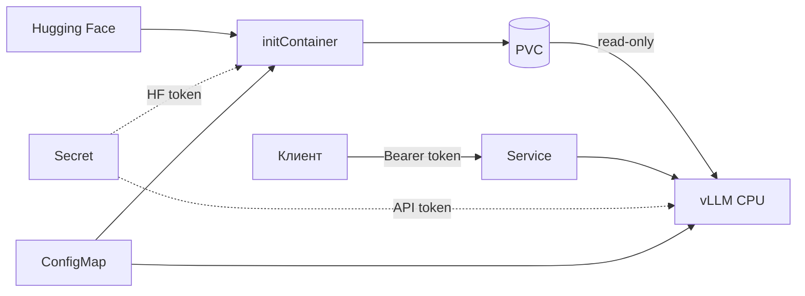

# Архитектура

[README](../README.md) · [Эксплуатация](RUNBOOK.md) · [Проверки](VALIDATION.md)

Один Pod с подготовительным контейнером загрузки и сервером vLLM.
Оба используют общий PVC: загрузчик пишет файлы, сервер читает готовую модель.

## Загрузка и хранение модели

Путь snapshot определяется ID модели и полным commit SHA.
[Загрузчик](../src/app/download_model.py) использует файловую блокировку,
скачивает файлы во временный каталог и создаёт manifest с размерами и SHA256.
Готовый каталог становится доступен через атомарное переименование.
Прерванная загрузка сохраняется для продолжения; повреждённая готовая копия отклоняется.

[model_store.py](../src/app/model_store.py) проверяет целостность и допустимость путей.
Для готового snapshot загрузчик выполняет проверку без импорта Hugging Face и сетевых обращений.
[Launcher](../src/app/launch.py) повторно проверяет файлы и передаёт vLLM локальный путь,
включая `HF_HUB_OFFLINE=1` и `TRANSFORMERS_OFFLINE=1`.

HF-токен получает только initContainer. Основной сервер монтирует модель read-only;
пересоздание Pod сохраняет PVC.

## Логирование

Вместо стандартных request/output/access-логов используется
[audit middleware](../src/app/audit.py): request ID, метод, известный маршрут,
HTTP-статус и длительность. Неизвестные маршруты заменяются на `other`.
Тело, заголовки, query string и клиентский request ID не записываются.
Streaming передаётся без буферизации всего ответа.

[SafeJsonFormatter](../src/app/safe_logging.py) сохраняет только разрешённые поля.
Сторонние сообщения, аргументы, тексты исключений и строки traceback не форматируются.
Для диагностики остаются logger, уровень, место вызова и тип ошибки;
детализация намеренно ограничена ради приватности.

[sitecustomize.py](../src/sitecustomize.py) подключает конфигурацию до импорта vLLM
в Python-процессах, включая обработку warnings и необработанных исключений.
`VLLM_CONFIGURE_LOGGING=0` отключает стандартную конфигурацию vLLM;
Uvicorn использует тот же [logging.json](../config/logging.json).

## Доступ к API

[Bearer middleware](../src/app/auth.py) проверяет основные и вспомогательные маршруты.
Без токена доступны GET/HEAD `/health`, `/metrics` и preflight OPTIONS.
Сравнение SHA256-хэшей токенов выполняется через `compare_digest`.
Аудит охватывает и отклонённые запросы.

Secret `vllm-secrets` подключается через `secretKeyRef`.
Значения токенов не передаются флагами запуска и не входят в версионируемые конфигурации.

## Kubernetes

Ресурсы описаны в [deployment.yaml](../k8s/base/deployment.yaml).

| Механизм | Настройка |
| --- | --- |
| Пользователь | UID/GID `10001`, `runAsNonRoot: true`, `fsGroup: 10001` |
| Права процесса | `allowPrivilegeEscalation: false`, capabilities `drop: ALL` |
| Файловая система | read-only root filesystem; отдельные `/tmp` и `/dev/shm` |
| Изоляция | seccomp `RuntimeDefault`, namespace с Pod Security `restricted` |
| Kubernetes API | ServiceAccount-токен не монтируется |
| Состояние сервера | startup, readiness и liveness probes на `/health` |
| Обновление | Одна реплика, стратегия `Recreate`, PVC сохраняется |

`enableServiceLinks: false` исключает конфликт переменных Service с настройками vLLM,
в частности `VLLM_PORT`. Образы загружаются в Minikube локально, `imagePullPolicy: Never`.

## Конфигурация и воспроизводимость

Kustomize собирает ConfigMap из [model.env](../k8s/base/config/model.env),
[runtime.env](../k8s/base/config/runtime.env) и [inference.json](../k8s/base/config/inference.json).
При изменении данных меняются имя ConfigMap и Pod template: сервер перезапускается,
образ и PVC остаются прежними. Launcher принимает только разрешённые параметры;
переопределить защиту логов, middleware, токен или путь модели через JSON нельзя.

Для базового Python-образа зафиксирован digest. Версия модели определяется полным commit SHA.
Прямые и транзитивные Python-зависимости закреплены с SHA256;
используются CPU-сборки vLLM и PyTorch. Кэш установки находится в отдельном
BuildKit mount и не включается в runtime-образ.
[Сборка и обновление зависимостей →](RUNBOOK.md#сборка-и-зависимости)

## Источники

- [vLLM: CPU installation](https://docs.vllm.ai/en/v0.27.1/getting_started/installation/cpu/)
- [vLLM: CPU Dockerfile](https://github.com/vllm-project/vllm/blob/v0.27.1/docker/Dockerfile.cpu)
- [SmolLM2-135M-Instruct](https://huggingface.co/HuggingFaceTB/SmolLM2-135M-Instruct)
- [Minikube](https://minikube.sigs.k8s.io/docs/start/)
