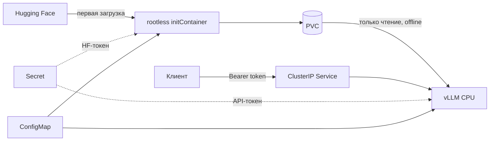

# Архитектура и конфигурация



## Snapshot модели

Каталог на PVC зависит от model ID и полного commit SHA. Скачивание идёт во
временный каталог. После загрузки создаётся manifest с размерами и SHA256
файлов, затем каталог атомарно переименовывается. Файловая блокировка
сериализует загрузки. Прерванная загрузка сохраняется для продолжения.
Готовая повреждённая копия отклоняется.

При готовом snapshot загрузчик проверяет файлы без импорта Hugging Face
и сетевых вызовов. Сервер повторно проверяет snapshot и использует локальный путь
с `HF_HUB_OFFLINE=1` и `TRANSFORMERS_OFFLINE=1`. HF-токен передаётся только
initContainer, а не основному процессу.

## Логирование и аутентификация

Реализация: [logging.json](../config/logging.json),
[SafeJsonFormatter](../src/app/safe_logging.py),
[audit middleware](../src/app/audit.py), [sitecustomize](../src/sitecustomize.py).

Лог обращения содержит серверный request ID, разрешённый метод, известный
маршрут, статус и длительность. Неизвестные пути заменяются на `other`.
Тела, заголовки, query string и клиентский request ID не используются
для логирования. Streaming-ответы не буферизуются middleware.

Стандартные request/output/access-логи vLLM отключены. Formatter не вызывает
`getMessage`, `formatException` или `formatStack` для сторонних логов.
Сохраняются уровень, имя логгера, место вызова, тип ошибки и место её возникновения.
Текст исключений, значения аргументов и строки кода в структурированные логи
не попадают. Это сознательно уменьшает детализацию диагностики.

`sitecustomize` настраивает логирование до импорта vLLM во всех Python-процессах,
перехватывает warnings и необработанные исключения. `VLLM_CONFIGURE_LOGGING=0`
отключает стандартную настройку и префиксы процессов vLLM; Uvicorn получает
отдельный `--log-config-file` с тем же безопасным formatter.

[Bearer middleware](../src/app/auth.py) защищает все маршруты, включая
вспомогательные API за пределами `/v1`. Без токена доступны GET/HEAD
`/health`, `/metrics` и CORS preflight OPTIONS. Сравнение хэшей токенов
использует constant-time `compare_digest`. Аудит находится снаружи проверки
токена, поэтому отклонённые обращения тоже учитываются.

## Kubernetes

Оба контейнера запускаются с UID/GID `10001`, read-only root filesystem,
`allowPrivilegeEscalation: false`, сброшенными capabilities и `RuntimeDefault`
seccomp. ServiceAccount-токен не монтируется. В namespace включена политика
Pod Security `restricted`. Для `/tmp` и `/dev/shm` выделены отдельные volume.

`enableServiceLinks: false` предотвращает конфликт переменных Kubernetes Service
с внутренними переменными vLLM, в частности `VLLM_PORT`. Requests/limits
и startup/readiness/liveness probes заданы в Deployment.

Kustomize вычисляет хэш ConfigMap и меняет ссылку в Pod template. Поэтому
изменение параметров вызывает перезапуск без пересборки образа. Стратегия
`Recreate` исключает одновременную работу двух экземпляров; PVC сохраняется.

Launcher принимает только разрешённые параметры инференса. Настройки,
подменяющие токен, middleware, путь модели или защиту логов, отклоняются.

## Ручная сборка и другой кластер

```shell
docker build -t kaspersky-model-downloader:dev -f downloader/Dockerfile .
docker build -t kaspersky-vllm-cpu:dev -f Dockerfile .
kubectl kustomize k8s/overlays/local
```

По умолчанию `imagePullPolicy: Never`: образы загружаются в Minikube через
`minikube image load`. Для другого кластера загрузите образы на его узлы либо
в свой registry и поменяйте имена образов и pull policy через Kustomize.
Нужны default StorageClass и Secret `vllm-secrets` с ключами `api-token`
и `hf-token` в namespace `llm-inference`.

## Зависимости и кэш сборки

Прямые зависимости находятся в `requirements.in` и `downloader/requirements.in`.
Полные lock-файлы предназначены для Linux amd64 / Python 3.12 и содержат SHA256.
CPU wheel vLLM закреплён URL и хэшем; PyTorch устанавливается с
`--torch-backend cpu`. Для обновления нужен `uv==0.13.6`:

```powershell
powershell -NoProfile -ExecutionPolicy Bypass -File .\scripts\lock.ps1
```

Для uv внутри проекта добавьте `-Uv .\.local\tools\bin\uv.exe`.
После обновления зависимостей повторно проверяются сборка и инференс.

Кэш uv хранится в отдельном BuildKit cache mount. `--link-mode copy` исключает
зависимость установленных файлов от этого mount. С готовым кэшем можно выполнить
установку Python-зависимостей offline:

```shell
docker build --build-arg UV_OFFLINE=1 -t kaspersky-vllm-cpu:dev .
```

Этот параметр относится к установке зависимостей из lock-файла. Bootstrap uv
и системные пакеты при отсутствии соответствующих слоёв всё ещё требуют сеть.

## Источники

- [vLLM 0.27.1: CPU](https://docs.vllm.ai/en/v0.27.1/getting_started/installation/cpu/)
- [CPU Dockerfile vLLM](https://github.com/vllm-project/vllm/blob/v0.27.1/docker/Dockerfile.cpu)
- [SmolLM2-135M-Instruct](https://huggingface.co/HuggingFaceTB/SmolLM2-135M-Instruct)
- [Minikube](https://minikube.sigs.k8s.io/docs/start/)
